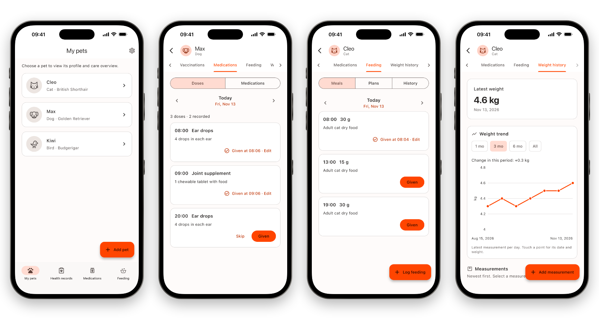

# Patilog

Patilog is an offline pet care tracker for iPhone and Android. It keeps each
pet's health and daily care records in one place: weight history, vet visits,
vaccinations, medications and feeding, with local reminders.

The app is available in English and Turkish, with light and dark themes.

Website: [berkecankoc.github.io/patilog-site](https://berkecankoc.github.io/patilog-site/) · [Privacy policy](https://berkecankoc.github.io/patilog-site/privacy/) · [Support](https://berkecankoc.github.io/patilog-site/support/)

<picture>
  <source media="(prefers-color-scheme: dark)" srcset="docs/screenshots/overview-dark.png">
  
</picture>

## Features

- Pet profiles for dogs, cats, birds and other pets, with an optional photo
- Weight history with a chart; the pet's current weight is the latest measurement
- Vet visits and vaccinations, including next-dose plans
- Medications with daily or every-N-days schedules and per-dose tracking
- Feeding plans with daily meal tracking (grams offered) and history
- Local reminders for meals, medication doses and vaccinations
- Combined views across all pets for health records, medications and feeding

## Privacy

Patilog has no accounts, servers, analytics or ads. Records are stored in a
local SQLite database on the device, and pet photos are copied into the app's
private storage. The Android release build does not request the `INTERNET`
permission. Device backups (iCloud or Google) may include app data, depending
on the user's system settings.

## Development

Requirements: Flutter 3.47.8 or later (Dart 3.13), Xcode for iOS and the
Android SDK for Android. Supported targets are iPhone on iOS 15+ and Android
7.0+ (API 24).

```bash
flutter pub get
flutter run
flutter analyze
flutter test
```

The code is organized by feature under `lib/features/<feature>/` with
`data`, `domain` and `presentation` layers; shared infrastructure lives in
`lib/core/`. Tests mirror the source tree under `test/`. Translations are in
`lib/l10n/app_en.arb` and `lib/l10n/app_tr.arb`.

### Android release signing

Release builds are signed with the key described in `android/key.properties`
(ignored by Git):

```properties
storeFile=/absolute/path/to/upload-keystore.jks
storePassword=...
keyAlias=upload
keyPassword=...
```

Without this file, release builds fall back to the debug key so they can still
be built and run locally. Google Play does not accept debug-signed uploads.

## Contributing

Issues and pull requests are welcome. By contributing, you agree that your
contribution is licensed under the GNU GPL version 3 or later together with the
app store permission described in [NOTICE.md](NOTICE.md).

## License

Patilog is licensed under the [GNU General Public License v3.0 or later](LICENSE),
with an additional permission for distribution through mobile app stores. The
Patilog name and logo are not covered by the GPL. See [NOTICE.md](NOTICE.md) for
details.
